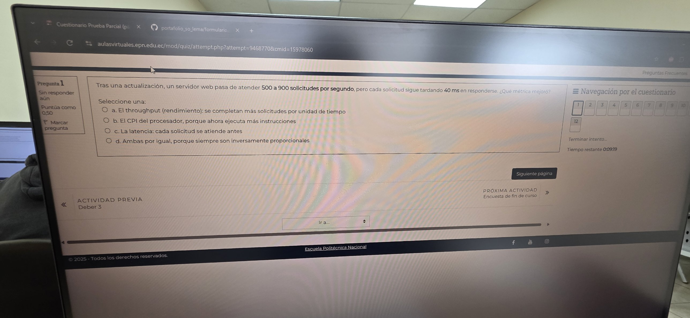

# Práctica 01 · Throughput vs latencia

**Enunciado.** Tras una actualización, un servidor web pasa de atender 500 a 900 solicitudes por segundo, pero cada solicitud sigue tardando 40 ms en responderse. ¿Qué métrica mejoró?

a. El throughput (rendimiento): se completan más solicitudes por unidad de tiempo
b. El CPI del procesador, porque ahora ejecuta más instrucciones
c. La latencia: cada solicitud se atiende antes
d. Ambas por igual, porque siempre son inversamente proporcionales

**Respuesta: a.**

**Solución.**
- **Throughput** = trabajo completado por unidad de tiempo. Subió de 500 a 900 sol/s, es decir ×1,8 (+80 %).
- **Latencia** = tiempo que tarda una sola solicitud. Sigue en 40 ms: no cambió (descarta c y d).
- Throughput y latencia **no** son inversamente proporcionales en general: con trabajo en paralelo (varios núcleos, pipeline, varias solicitudes a la vez) se puede subir el throughput sin tocar la latencia (descarta d).
- El **CPI** son ciclos por instrucción; no se deduce del número de solicitudes ni de más instrucciones ejecutadas (descarta b).

**Fórmula / concepto:** rendimiento = tareas / tiempo; latencia = tiempo por tarea (semana 1, métricas de rendimiento).

